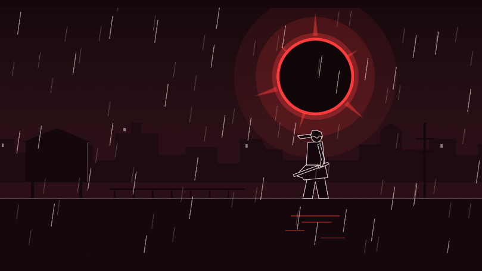

# Crimson Rain

**An 8-second, code-drawn anime-inspired animation built with HTML, SVG, JavaScript, and GSAP.**



Crimson Rain is a small creative-coding experiment: a single HTML composition defines the artwork, shot layout, and seekable animation timeline. It was developed as an independent exercise using the [html-anime](https://github.com/blixvip/html-anime) workflow and validated with [HyperFrames](https://github.com/heygen-com/hyperframes).

The art is intentionally simple and vector-based. **This is not an AI-generated cinematic video**, and no text-to-video model was used. A coding agent assisted in implementing the composition.

## At a glance

| Property | Value |
| --- | --- |
| Duration | 8 seconds |
| Frame rate | 24 fps (192 frames) |
| Resolution | 1920 × 1080 (16:9) |
| Scenes | 3 shots; one action-focused *sakuga* shot |
| Source | One self-contained composition file, `index.html` (GSAP loads from a CDN) |
| Dialogue / audio | None |
| Color script | Vermilion eclipse (10 specified colors) |
| Rendering / validation | HyperFrames CLI |

## Storyboard

| Time | Shot | Description |
| --- | --- | --- |
| 0.00–2.40 s | Establishing | A swordsman waits on a rooftop beneath a red eclipse; rain and a subtle camera push establish the setting. |
| 2.40–6.00 s | Sakuga | A short sword-drawing action uses anticipation, held poses, and hand-authored smear frames. |
| 6.00–8.00 s | Closing | A close-up, a brief expression change, and a final fade to black. |

The rain layers are deterministic; the GSAP timeline is registered as `film` so the renderer can seek to exact points in time.

## Requirements

- Node.js **22+**
- FFmpeg available on `PATH` (required for rendering)
- Network access to load **GSAP 3.14.2** from jsDelivr, as referenced by the composition

HyperFrames is invoked at version `0.8.210`, the version used during the initial test. No global installation is necessary.

## Run locally

From the directory containing `index.html`:

```powershell
npx --yes hyperframes@0.8.210 lint .
npx --yes hyperframes@0.8.210 check . --snapshots
npx --yes hyperframes@0.8.210 preview . --open
```

The preview command starts a local development server; use the URL it prints. Stop it with `Ctrl+C` when finished.

To render an MP4:

```powershell
npx --yes hyperframes@0.8.210 render . --fps 24
```

Pass `--fps 24` explicitly: the composition does not declare a frame rate, and without the flag HyperFrames falls back to 30 fps. HyperFrames writes the result to its configured/default output location (by default a `renders/` folder, which is git-ignored); refer to the CLI output for the actual file path. If the project includes `assets/demo.mp4`, it is the exported preview and not a separate source composition.

> `npx` can download and execute third-party code. Review dependencies before running commands in an untrusted environment.

## Validation and known limitations

During development, HyperFrames `0.8.210` reported **Check passed** with:

- Runtime, motion, and craft checks: **zero errors and zero warnings**.
- Lint: **zero errors**, five structure/size warnings recommending sub-compositions.
- Layout: **zero errors**, three overflow warnings on SVG artwork, plus informational rain/camera overflow observations.
- Audio: intentionally absent.

The short intentionally stays in one HTML file, matching the original html-anime render skill. The SVG overflow and camera clipping should be judged visually; the warnings were **not** represented as fully resolved. Check results describe the tested version, not an unconditional guarantee about future changes or newer HyperFrames versions.

### Lessons learned

1. A valid render pipeline does not necessarily imply high visual fidelity.
2. Frame-accurate drawing swaps and deterministic effects are useful when rendering by seeking across a timeline.
3. Animated layers must end within their intended clips; rain loops were adjusted after a read-only audit found overrun.
4. Separating a standalone demo from the original tool repository makes publication, licensing, and review simpler.

## Structure

```text
.
├── index.html                 # Composition source (added from the local project)
├── README.md
├── LICENSE
├── THIRD_PARTY_NOTICES.md
├── SECURITY.md
├── .gitignore
├── assets/
│   ├── preview.png            # Cropped screenshot of the actual output
│   └── demo.mp4               # Optional: add after rendering and privacy review
└── docs/
    ├── IMPLEMENTATION.md
    └── PUBLISH_CHECKLIST.md
```

## Credits

- [html-anime](https://github.com/blixvip/html-anime) by **blixvip** — the shot-sheet workflow, drawing constraints, and technical reference; licensed under MIT.
- [HyperFrames](https://github.com/heygen-com/hyperframes) by **HeyGen** — validation, preview, and video rendering.
- [GSAP](https://gsap.com/) — JavaScript animation engine loaded from a CDN. GSAP is a dependency, **not** included or relicensed in this repository.
- A coding assistant was used to implement and review the composition; the work was manually directed and technically validated.

See [third-party notices](THIRD_PARTY_NOTICES.md) for attribution and license information.

## License

The original files in this standalone project are offered under the [MIT License](LICENSE), subject to any applicable third-party notices. All external projects retain their own licenses and copyrights.
